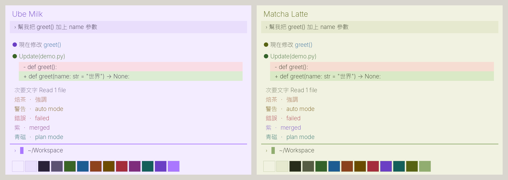
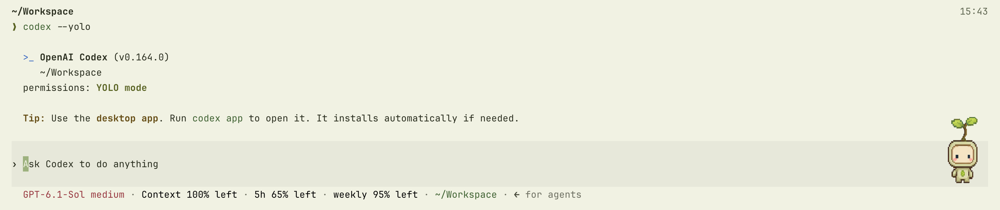

# 🛠️ My Dotfiles

Minimal, fast setup for macOS using **Ghostty** + **Zsh** + **Starship**, with one palette shared by
Ghostty, Claude Code and Codex.



## ⚡️ Quick Setup

### 1. Clone & Install Dependencies

Assumes you have [Homebrew](https://brew.sh) installed.

```bash
# 1. Clone repo
git clone https://github.com/YOUR_USERNAME/dotfiles.git ~/dotfiles
cd ~/dotfiles

# 2. Install all dependencies using Brewfile
brew bundle install
```

### 2. Link Dotfiles

```bash
# Backup old configs (ignore errors if files don't exist)
mv ~/.zshrc ~/.zshrc.bak
mv ~/.zshenv ~/.zshenv.bak
mv ~/.zprofile ~/.zprofile.bak
mv ~/.config/starship.toml ~/.config/starship.toml.bak
mv ~/.config/atuin/config.toml ~/.config/atuin/config.toml.bak

# Link zsh configs
ln -s ~/dotfiles/zsh/.zshrc ~/.zshrc
ln -s ~/dotfiles/zsh/.zshenv ~/.zshenv
ln -s ~/dotfiles/zsh/.zprofile ~/.zprofile

# Link starship config
mkdir -p ~/.config
ln -s ~/dotfiles/starship/starship.toml ~/.config/starship.toml

# Link Ghostty config
mkdir -p ~/.config/ghostty
ln -s ~/dotfiles/ghostty/.config/ghostty/config ~/.config/ghostty/config

# Link Atuin config
mkdir -p ~/.config/atuin
ln -s ~/dotfiles/atuin/.config/atuin/config.toml ~/.config/atuin/config.toml

# Link tmux config
mkdir -p ~/.config/tmux
ln -s ~/dotfiles/tmux/.config/tmux/tmux.conf ~/.config/tmux/tmux.conf

# Theme switcher (see "Themes" below)
mkdir -p ~/.local/bin
ln -s ~/dotfiles/ghostty/design-system/palettes.py ~/.local/bin/term-theme

# Link iTerm2 preferences
ln -s ~/dotfiles/iterm2/com.googlecode.iterm2.plist ~/Library/Preferences/com.googlecode.iterm2.plist
```

Claude Code status line: point `statusLine` in `~/.claude/settings.json` at the script.

```json
"statusLine": { "type": "command", "command": "/bin/bash ~/dotfiles/claude/statusline-atelier.sh" }
```

### 3. Finalize

```bash
# Refresh Shell
source ~/.zshrc

# Apply the terminal theme to Ghostty, Claude Code and Codex
term-theme apply ube-milk
```

---

## 🎨 Themes

Two finished light themes, each generated from one palette in
[`ghostty/design-system/palettes.py`](ghostty/design-system/palettes.py):

| Theme | Slug | Canvas | Ink | Brand | Accents |
| :-- | :-- | :-- | :-- | :-- | :-- |
| **Ube Milk** (default) | `ube-milk` | `#f3ecff` | `#2a2238` | ube `#6b3fc4` | `#aa77ff` cursor, 裏柳 green for success |
| **Matcha Latte** | `matcha-latte` | `#f1f2e1` | `#272c1b` | 苔 moss `#576313` | 柳染 `#91ad70` cursor, 松葉 green for success |

Matcha Latte running Codex in Ghostty:



```bash
term-theme list                    # themes; * marks the active one, drafts are labelled
term-theme preview ube-milk matcha-latte   # palette cards as a PNG, no terminal windows
term-theme apply matcha-latte --dry-run    # show the diff only
term-theme apply matcha-latte      # switch Ghostty, Claude Code and Codex together
term-theme check                   # WCAG contrast report
```

How it works:

- One palette produces the Ghostty colors (inside the marked theme block of the Ghostty config),
  a Claude Code custom theme (`~/.claude/themes/<slug>.json`), and sets Codex to `base16-256`
  so its syntax colors follow the Ghostty ANSI palette.
- Every text color is checked at **4.5:1 or better** against the canvas, message, diff and
  selection backgrounds; `apply` refuses a theme that fails.
- `apply` backs up all three configs to `~/.local/state/ghostty-themes/`, validates the Ghostty
  config (restoring on failure), reloads Ghostty and reads the result back.
- Light themes turn off macOS glass: in Ghostty 1.3.1, glass combined with `minimum-contrast`
  can turn dark text white.
- The Claude Code status line, Starship and tmux use ANSI color slots, so they follow whichever
  theme is active.
- Already running sessions keep their old colors: use `/theme` in Claude Code, restart Codex.

---

## 📦 What's Included

### Shell & Prompt

- **Zsh** - Shell configuration with .zshrc, .zshenv, and .zprofile
- **Starship** - Fast, customizable prompt
- **Zoxide** - Smarter cd command

### Terminal

- **Ghostty** - GPU-accelerated terminal emulator (primary)
- **iTerm2** - Feature-rich terminal emulator for macOS (backup)

### Productivity Tools

- **atuin** - Shell history search (replaces fzf Ctrl+R)
- **direnv** - Per-directory environment auto-loading
- **lazygit** - TUI git client
- **uv** - Fast Python project/runtime manager
- **mise** - Per-project tool versions and task runner
- **yazi** - Terminal file manager
- **zellij** - Terminal multiplexer alternative
- **tmux** - Optional remote / long-running session tool

### Development Tools

- **nvm** - Node.js version manager
- **pyenv** - Python version manager

### Shell Enhancement

- **zsh-autosuggestions** - Fish-like autosuggestions
- **zsh-syntax-highlighting** - Real-time syntax highlighting

---

## ⌨️ Shell Shortcuts

| Command   | Description                                              |
| :-------- | :------------------------------------------------------- |
| `z <dir>` | Smart jump to directory (e.g., `z dot` -> `~/dotfiles`). |
| `src`     | Reload `.zshrc`.                                         |
| `croot`   | Jump to the current git repository root.                 |
| `take x`  | Create a directory and cd into it.                       |
| `ff`      | Fuzzy-find files with preview.                           |
| `fcd`     | Fuzzy-find and cd into a directory.                      |
| `uvr`     | Shortcut for `uv run` when `uv` is installed.            |
| `mr`      | Shortcut for `mise run` when `mise` is installed.        |

## Ghostty Workflow

| Shortcut             | Description                                    |
| :------------------- | :--------------------------------------------- |
| `Alt+Space`          | Toggle quick terminal.                         |
| `Cmd+D`              | Split right.                                   |
| `Cmd+Shift+D`        | Split down.                                    |
| `Cmd+Shift+Enter`    | Zoom/unzoom the current split.                 |
| `Cmd+Up` / `Cmd+Down` | Jump between shell prompts in scrollback.     |
| `Cmd+Shift+P`        | Open Ghostty command palette.                  |
